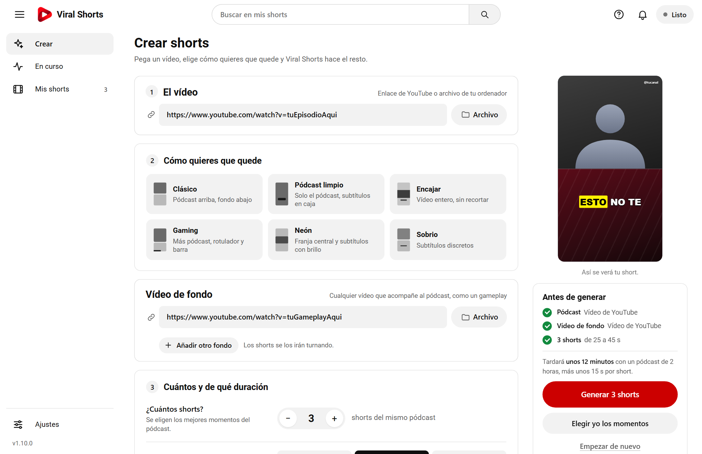
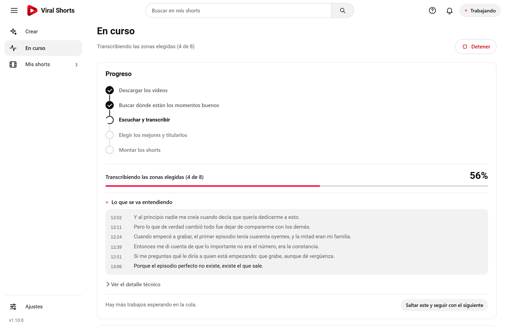
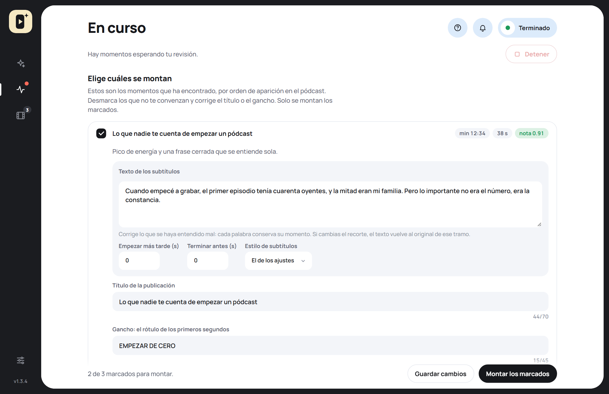
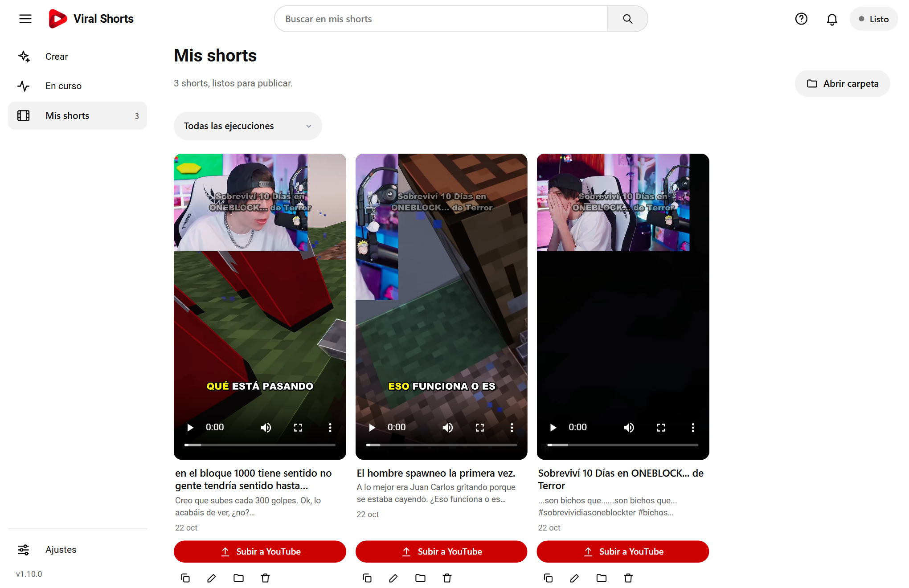
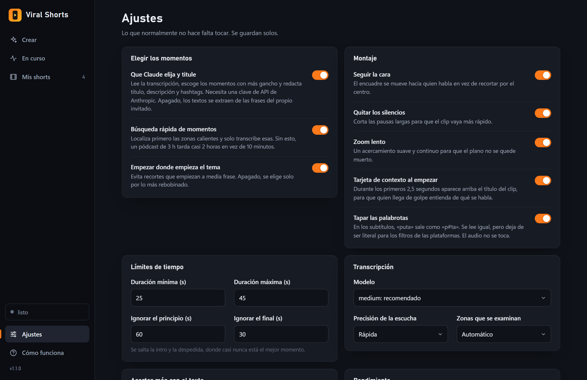
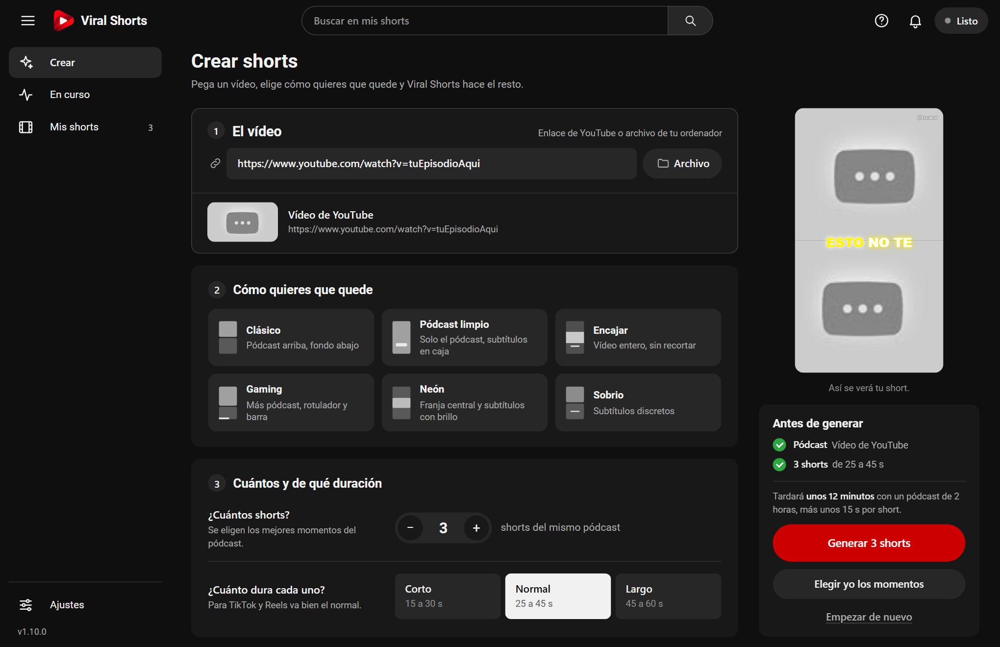

<p align="center">
  
</p>

<h1 align="center">Viral Shorts</h1>

<p align="center">
  <b>De un pódcast de horas a shorts verticales con subtítulos, en unos clics.</b><br>
  Encuentra los mejores momentos, los recorta siguiendo la cara y los deja listos para TikTok, Reels y YouTube Shorts.
</p>

<p align="center">
  <a href="https://github.com/practicas-hugosanz/viralshorts-releases/releases/latest"></a>
  
  
  
</p>

<p align="center">
  
</p>

## Cómo funciona

1. **Pega un pódcast** de YouTube (o elige un archivo) y **un vídeo de fondo**, por ejemplo un gameplay.
2. **Encuentra los momentos buenos** con lo que más rebobina la gente en YouTube, la energía del audio y la transcripción.
3. **Los monta en vertical**: recorta siguiendo la cara, quita silencios, pone un zoom lento y quema los subtítulos palabra a palabra.
4. **Te lo deja listo**: cada short con su título, gancho y hashtags para copiar y publicar.

## Qué incluye

**Elegir bien**
- Preselección por *most replayed* de YouTube y energía del audio: solo se transcribe lo que importa, así un pódcast de 3 horas no tarda 3 horas.
- Empieza donde empieza el tema, no a media frase.
- **Elegir yo los momentos**: el pódcast entero en una línea de tiempo, como en un editor de vídeo; marcas dónde empieza y acaba cada trozo, lo seleccionas y cada trozo es un short.
- Funciona **sin cuenta y sin IA de pago**; con una clave de Claude los textos están redactados en vez de extraídos.

**Montar bien**
- Reencuadre que sigue la cara de quien habla y recorte de silencios.
- Subtítulos palabra a palabra con la palabra activa resaltada, y las palabrotas tapadas si quieres.
- Aceleración por tarjeta gráfica (NVIDIA, Intel o AMD) cuando la hay, también para **transcribir**: con una AMD RX 6600 va de 2,8 a 4,9 veces más rápido que con el procesador.
- **Dos personas en pantalla partida**: si salen las dos a la vez, una arriba y otra abajo, y la palabra que suena va del color de quien la dice.

**Hacerlo tuyo**
- **Composición**: dividido (con el reparto que quieras), solo el pódcast a pantalla completa, o el pódcast en una franja sobre el fondo.
- **Cinco estilos de subtítulos**: Clásico, Caja, Rotulador, Neón y Sobrio.
- **Tu marca**: logo y usuario del canal en la esquina que prefieras.
- **Formatos** 9:16, 4:5 y 1:1, **efectos de sonido** (whoosh y pitido de censura), **portada con el gancho**, **pantalla final** y **fondo** variable (punto, velocidad, desenfoque).
- **Kits de marca**: logo, usuario y estilo guardados para aplicarlos con un clic.
- **Música de fondo** que baja sola cuando habla alguien, y una **barra de progreso** sobre el vídeo.
- **Edición por clip**: corrige el texto de los subtítulos, recorta cada clip y elige su estilo antes de montar.
- **Perfiles**: guarda todos tus ajustes con un nombre y recupéralos con un clic.
- **Acertar más con el texto**: vuelve a transcribir los clips elegidos con un modelo mayor, y añade nombres difíciles y correcciones fijas.
- **Subtítulos en otro idioma**: al inglés sin conexión; al español, francés, portugués, alemán o italiano con Claude.
- **Emojis según lo que se dice** («dinero» 💰, «miedo» 😱, «jajaja» 😂…) encima de los subtítulos.
- **Varios vídeos de fondo** que se van turnando entre shorts.
- **Para editar fuera**: los subtítulos en `.srt` y el mismo short sin ningún texto encima.

**Cómodo de usar**
- Aplicación de escritorio con instalador, sin consola ni ficheros `.bat`.
- Transcripción en directo mientras trabaja, cola de trabajos que puedes reordenar y biblioteca de todos tus shorts con búsqueda.
- **Sube a YouTube Shorts** con un clic, con su título, texto y hashtags (privado, oculto o público).
- **Sigue canales**: cuando publican un episodio nuevo, se pone en la cola solo.
- Borra el vídeo descargado al terminar para no llenar el disco.
- Se actualiza sola desde GitHub.

## Capturas

<table>
  <tr>
    <td width="50%"><br><sub><b>En curso.</b> Cada paso, la transcripción en directo y la cola de trabajos.</sub></td>
    <td width="50%"><br><sub><b>Revisión.</b> Marca los momentos que valen y corrige títulos y ganchos.</sub></td>
  </tr>
  <tr>
    <td width="50%"><br><sub><b>Mis shorts.</b> Todo lo generado, con búsqueda, título editable y texto para copiar.</sub></td>
    <td width="50%"><br><sub><b>Ajustes.</b> Lo que normalmente no hace falta tocar, por apartados: YouTube, canales, tarjeta gráfica…</sub></td>
  </tr>
  <tr>
    <td colspan="2"><br><sub><b>Tema claro u oscuro</b>, según tu Windows. Aquí, la composición <i>Dos personas</i> con subtítulos neón.</sub></td>
  </tr>
</table>

## Instalación

1. Descarga **`viralshorts-setup-<versión>.exe`** de [la última versión](https://github.com/practicas-hugosanz/viralshorts-releases/releases/latest) y ejecútalo. Se instala para tu usuario, sin permisos de administrador.
2. Abre **Viral Shorts** desde el menú Inicio. La primera vez descarga ffmpeg, yt-dlp y whisper.cpp (unos 120 MB); las siguientes abre al momento.
3. Los modelos de voz (de 75 MB a 3 GB, según la calidad) se descargan solos, con barra de progreso, cuando hacen falta.

> Windows puede mostrar un aviso de SmartScreen porque el instalador todavía no está firmado: pulsa **Más información → Ejecutar de todos modos**.

**Requisitos:** Windows 10 o 11 de 64 bits y conexión a internet para la primera vez. Necesita el *WebView2 Runtime* de Microsoft, que ya trae Windows 11 y las versiones recientes de Windows 10; si falta, se abre en el navegador.

## Tu primer short

1. En **Crear**, pega el enlace del pódcast y el del vídeo de fondo.
2. Elige cuántos shorts quieres, cuánto duran y cuánto cuidado con el texto (*Equilibrado* va bien para empezar). Si quieres, cambia el aspecto en la pestaña **Aspecto**.
3. Pulsa **Generar** (el botón dice cuántos: «Generar 3 shorts») y mira cómo avanza en **En curso**. Cuando termina, están en **Mis shorts**.

Si prefieres decidir tú qué trozos se montan, usa **Elegir yo los momentos**: descarga el pódcast y te lo enseña con su línea de tiempo (lo más visto en YouTube arriba, la onda del sonido abajo). Marca el inicio y el final con los botones, con las teclas I y O o arrastrando sobre la onda, pulsa **Seleccionar este trozo** y, cuando tengas los que quieras, **Montar**.

## ¿Hace falta Claude?

No. Elegir los momentos funciona sin él, y los títulos, ganchos y hashtags se generan a partir de la mejor frase que ya dice el invitado. Con una clave de la API de Anthropic en la variable `ANTHROPIC_API_KEY`, esos textos se redactan en vez de recortarse, y se nota.

## Actualizaciones

La aplicación mira sola si hay una versión nueva (al abrir y cada 3 horas) y ofrece instalarla con un clic: descarga el instalador, comprueba su huella SHA-256 y se reinicia ya actualizada. No actualiza con un trabajo en marcha.

## Línea de comandos

La aplicación y la línea de comandos hacen exactamente lo mismo:

```bash
viralshorts --podcast <URL> --background <URL_gameplay>               # lo normal
viralshorts --podcast <URL> --background <URL> --dry-run              # ver qué elegiría, sin montar
viralshorts --podcast <URL> --background <URL> --plan-out plan.json   # elegir ahora y revisar
viralshorts --from-plan plan.json --only 1,4                          # montar solo lo que valga
viralshorts --podcast <URL> --background <URL> --moments 754-790,2462-2493   # montar justo estos trozos (en segundos)
viralshorts doctor                                                    # qué herramientas ve
```

Cualquier ajuste se puede cambiar sin tocar el YAML: `--set subtitles.style=marker --set layout.mode=center`.

## Historial de cambios

Cada versión publicada tiene aquí su entrada (`install\publicar.ps1` no deja
publicar una versión sin ella). Lo más reciente, primero.

### 1.6.1 (2026-10-28)

- Ajustes rehecho para que no sea un laberinto: en vez de once desplegables,
  seis apartados con nombre claro (Cómo queda el short, Elegir los momentos,
  Texto y subtítulos, YouTube, Archivos y velocidad, Aplicación), todo a la
  vista, con un índice lateral que sigue por dónde vas y un buscador.
- Cada ajuste dice para qué sirve en una línea, y los que ya se eligen en Crear
  (duración, calidad del texto) lo indican.

### 1.6.0 (2026-10-27)

- «Elegir yo los momentos» funciona ahora como un editor de vídeo: descarga el
  pódcast y lo enseña entero con una línea de tiempo (lo más visto en YouTube
  arriba y la onda del sonido abajo, con zoom de 30 s a 5 min). Marcas dónde
  empieza y dónde acaba cada trozo (con los botones, con las teclas I y O o
  arrastrando sobre la onda), lo seleccionas y, al montar, cada trozo es un
  short tal cual lo elegiste.
- Los trozos se pueden ver antes, cambiar o quitar, y se recuerdan aunque cierres
  la ventana.
- En la línea de comandos: `--prepare` y `--moments INICIO-FIN,...`.

### 1.5.3 (2026-10-25)

- El panel lateral enseña el nombre de cada apartado bajo su icono (Crear, En
  curso, Mis shorts, Ajustes), con el actual resaltado. También en ventanas
  estrechas.

### 1.5.2 (2026-10-25)

- Arreglo: con la composición «Solo el pódcast» (o «Dos personas») ya no hace
  falta vídeo de fondo. Antes, con el fondo vacío, «Generar» fallaba al momento
  con un aviso genérico y no aparecía nada en «En curso».
- Si algo falla antes de empezar, el aviso dice el motivo real en vez de mandar
  a «En curso».

### 1.5.1 (2026-10-25)

- Arreglo importante: si un clip empezaba (o acababa) con un rato sin voz, por
  ejemplo música, los subtítulos iban varios segundos por delante de lo que se
  dice. Ahora el vídeo y el audio se recortan igual que los subtítulos.
- La descarga de un modelo de voz ya no se pierde si se corta la conexión: sigue
  por donde iba, lo reintenta sola y, si se rinde, lo bajado se guarda para el
  siguiente intento. Dos descargas del mismo modelo (por ejemplo, el botón y un
  trabajo en marcha) ya no se pisan.
- «Añadir otro fondo» es ahora un botón en su sitio, y cada fondo extra tiene su
  botón «Archivo».

### 1.5.0 (2026-10-25)

- **Transcribir con tarjetas AMD e Intel**: un motor nuevo (Vulkan) que la
  aplicación ofrece descargar (unos 18 MB) cuando ve la tarjeta. Con una AMD
  RX 6600 transcribe de 2,8 a 4,9 veces más rápido que con el procesador. El
  tiempo estimado tiene en cuenta la tarjeta.
- **Dos personas en pantalla partida** (Aspecto › Composición): si salen las dos
  a la vez, una arriba y otra abajo, con los subtítulos en la costura y la
  palabra que suena del color de quien la dice.
- **Subtítulos en otro idioma**: al inglés sin conexión; al español, francés,
  portugués, alemán o italiano con Claude. El título y el gancho salen en ese
  idioma.
- **Subir a YouTube Shorts** desde Mis shorts, con título, texto y hashtags
  (Ajustes › Publicar en YouTube).
- **Seguir canales**: cuando publican un episodio nuevo se pone en la cola solo
  (Ajustes › Seguir canales).
- **Emojis según lo que se dice**, **varios vídeos de fondo que se turnan**, y
  para editar fuera, **los subtítulos en .srt** y **el short sin textos**.
- Arreglo: el filtro de bucles de Whisper de la 1.3.4 quitaba repeticiones de
  verdad («rápido, rápido, rápido y furioso»); ahora solo quita los bucles.

### 1.4.1 (2026-10-23)

- El panel de generar ya no parece un anuncio: es una lista de lo que falta
  (pódcast, vídeo de fondo) y de lo que va a salir, con el tiempo estimado, y el
  botón dice lo que hace: «Generar 3 shorts».
- Las opciones principales son preguntas claras («¿Cuántos shorts?», «¿Cuánto
  dura cada uno?», «¿Cuánto cuidado con el texto?», «¿En qué idioma hablan?»)
  con todas las opciones y su detalle a la vista para compararlas.
- «Buscar y revisar antes de montar» pasa a llamarse «Elegir yo los momentos».

### 1.4.0 (2026-10-23)

- Diseño nuevo: barra lateral oscura solo con iconos, panel blanco redondeado,
  tarjetas de color para el pódcast, el fondo y lo que quieres obtener (cuántos
  shorts, duración y calidad, con el valor en grande) y una tarjeta negra para
  generar. Botones en forma de píldora y letra Manrope, incluida en el programa.
  Tema claro y oscuro según Windows.
- Logo e icono nuevos (también en el instalador y en la pantalla del primer
  arranque).
- Al terminar de montar se borra el vídeo del pódcast descargado, que pesa cientos
  de MB. Si después rehaces un short se vuelve a descargar solo, y la transcripción
  y las caras ya calculadas se reconocen por el enlace, así que no se repiten. Tus
  propios ficheros y el vídeo de fondo no se borran nunca. Se puede desactivar en
  Ajustes › Dónde se guardan.

### 1.3.4 (2026-10-23)

- Arreglo: los subtítulos ya no pegan saltos. Un bloque seguía en pantalla unos
  milisegundos cuando ya había empezado el siguiente y uno de los dos se subía.
- Arreglo: las palabras que Whisper deja sin duración (varias en el mismo
  instante) ya no desaparecen ni se saltan el resaltado: se reparten el tiempo.
  La misma palabra repetida en el borde de dos frases sale una sola vez.
- Arreglo: cuando Whisper se atasca y repite un trozo en bucle («...son bichos
  que...» cada 2 segundos) se quita el bucle entero de la transcripción, de los
  subtítulos, de la descripción y de los hashtags. Una repetición suelta («no...
  no») se respeta. También se limpian las transcripciones ya guardadas.

### 1.3.3 (2026-10-21)

- Arreglo importante: al cambiar el enlace del pódcast (o del fondo), **Generar**
  seguía usando el vídeo del enlace anterior, porque se reutilizaba lo que había en
  la carpeta de trabajo sin mirar de qué enlace era. Ahora cada descarga recuerda
  de qué enlace es: si cambias de enlace se descarga el vídeo nuevo, y si es el
  mismo vídeo escrito de otra forma (`youtu.be/...` o `watch?v=...`) se reutiliza.
  Las descargas anteriores, sin esa marca, se reconocen por el id de YouTube o se
  vuelven a bajar.

### 1.3.2 (2026-10-19)

- Arreglo: en el formato 1:1 (y en 4:5) la vista previa se salía de su columna y
  tapaba el menú. Ahora siempre cabe.
- Las cinco plantillas de aspecto caben en una sola fila en ventanas más estrechas.

### 1.3.1 (2026-10-19)

- **Interfaz más sencilla.** *Crear* ahora va en dos pasos: **Contenido** (el
  pódcast, el fondo y lo básico) y **Aspecto**. En *Aspecto* hay cinco
  **plantillas** que cambian todo de un clic y secciones plegables (Composición,
  Subtítulos, Tu marca, Vídeo de fondo, Sonido y extras) que muestran en una línea
  lo que has elegido, sin abrirlas.
- *Ajustes* pasa a secciones plegables con una línea que dice qué hay dentro.
- Un único sitio para guardar tus ajustes («Mis ajustes guardados»): los kits de
  marca se unen a él.
- Textos más cortos en toda la pantalla.

### 1.3.0 (2026-10-19)

- **Formatos**: además de 9:16, salida en 4:5 (feed de Instagram) y 1:1.
- **Portada con el gancho escrito** encima, opcional.
- **Efectos de sonido**: un whoosh cuando aparece el rótulo, y un **pitido** que
  silencia la voz en las palabrotas (además de taparlas en el texto).
- **Vídeo de fondo**: un punto distinto en cada short, velocidad, desenfoque y
  oscurecido.
- **Pantalla final** con un mensaje («Sígueme para más») y tu usuario.
- **Kits de marca**: guarda el logo, el usuario, los subtítulos y la pantalla final
  como un kit y aplícalo con un clic, sin tocar el resto de ajustes.
- El aviso de versión nueva muestra las notas como una lista, y los controles de la
  revisión tienen nombre para los lectores de pantalla.
- **Tiempos medidos de verdad**: la interfaz estima ahora unos 3, 12 y 26 minutos
  para un pódcast de 2 horas (Rápida, Equilibrada y Máxima), sin contar la
  descarga; las mediciones están en `docs/funcionamiento.md`. La música baja
  de forma algo más suave.
- Pruebas nuevas: la interfaz entera con un navegador (`install\probar-interfaz.ps1`,
  41 comprobaciones) y las descargas del primer arranque de verdad.

### 1.2.0 (2026-10-19)

- **Edición por clip** en la revisión: corrige el texto de los subtítulos (cada
  palabra conserva su momento), recorta el principio y el final del clip, elige
  una plantilla de subtítulos solo para ese clip y deshaz los cambios cuando
  quieras.
- **Música de fondo** con bajada automática: una pista tuya que baja sola mientras
  alguien habla, con volumen ajustable.
- **Barra de progreso** que avanza durante el clip, arriba o abajo y del color que
  elijas.

### 1.1.0 (2026-10-19)

- **Composición del vídeo** (en *Crear*): *Dividido* (pódcast y fondo apilados, con
  40, 50, 60 o 70 % para el pódcast y la opción de poner el pódcast abajo),
  *Solo el pódcast* a pantalla completa siguiendo la cara, o *En el centro*, con
  el fondo a pantalla completa y el pódcast en una franja. El monitor lo refleja
  al momento.
- **Cinco estilos de subtítulos**: Clásico, Caja, Rotulador, Neón y Sobrio.
- **Tu marca**: logo (PNG) y usuario del canal en la esquina que elijas, con
  tamaño y opacidad; el usuario se coloca junto al logo.
- La tarjeta de contexto pasa arriba cuando no hay costura entre paneles.
- README renovado, con capturas, y la documentación técnica en `docs/funcionamiento.md`.

### 1.0.3 (2026-10-19)

- La aplicación pasa a llamarse **Viral Shorts**: ventana, menú Inicio, acceso
  directo, instalador y «Aplicaciones instaladas». Los accesos directos antiguos
  («viralshorts») se sustituyen al actualizar. Nada se mueve: el programa, la
  carpeta de datos y tus ajustes siguen donde estaban.
- Este historial de cambios.

### 1.0.2 (2026-10-19)

- **Afinar los clips elegidos**: tras elegir los momentos, el trozo de cada clip
  se vuelve a transcribir con un modelo mayor (`large-v3-turbo`, por ejemplo).
  Mejora los subtítulos, el título y el gancho; la calidad *Máxima* lo activa.
- **Nombres y palabras difíciles** y **correcciones fijas** (`mal = bien`) para
  la transcripción, en Ajustes.
- Modelo de voz `large-v3-turbo` disponible.
- **Transcripción en directo** en *En curso*: cada frase con su minuto, según
  se va entendiendo.
- Los botones de las tarjetas de *Mis shorts* caben siempre.

### 1.0.1 (2026-10-19)

- **Subtítulos que caben**: un bloque de palabras largas se parte en dos líneas
  y, si ni así cabe, se reduce el tamaño solo en ese bloque.
- Los **modelos de voz** que faltan se descargan, con barra de progreso, antes
  de lanzar y no a mitad del trabajo.
- **Aspecto del vídeo**: composición (dividido, solo el pódcast o en el centro),
  estilos de subtítulos (`subtitles.style`: classic, box, marker, neon, minimal) y
  marca (`brand.logo`, `brand.position`, `brand.scale`, `brand.opacity`,
  `brand.handle`). Todo se puede fijar también en `config.yaml` o con `--set`
  (`layout.mode`: stack, full, center; `layout.swap`; `layout.top_ratio`).
- **Vista previa real**: el monitor muestra un fotograma del pódcast y otro del
  fondo.
- **Mis shorts** enseña todas las ejecuciones, con búsqueda y filtro, y permite
  cambiar el título, abrir la carpeta o borrar un short.
- **Cola** editable: adelantar, atrasar, quitar y saltar el trabajo en marcha.
- **Perfiles** de ajustes con nombre.
- **Cookies del navegador** para vídeos de YouTube que piden iniciar sesión.
- Comprobación de actualizaciones cada 3 horas.
- Arreglo: la casilla de la carpeta de salida venía con «output» escrito y
  pisaba la carpeta de `config.yaml`.

### 1.0.0 (2026-10-19)

- **Interfaz nueva**: barra lateral (Crear, En curso, Mis shorts, Ajustes),
  monitor 9:16 con los subtítulos en vivo, progreso por pasos, revisión de
  momentos y tema claro u oscuro según Windows.

### 0.1.0 (2026-10-19)

- Primera versión: aplicación de escritorio con instalador, primer arranque que
  descarga ffmpeg, yt-dlp y whisper.cpp, y actualizaciones automáticas desde
  GitHub. Todo el programa migrado de Python a Rust.

## Documentación

- [**Viral Shorts por dentro**](docs/funcionamiento.md): cómo elige los momentos, cómo monta el vídeo, la configuración, la caché y el rendimiento.
- [`rust/README.md`](rust/README.md): el código, módulo a módulo.

## Desarrollo

Es un único ejecutable en Rust (`rust/`) con la interfaz en `web/` incrustada y un instalador de Inno Setup (`install/`).

```powershell
cargo test --release --manifest-path rust/Cargo.toml          # unos 360 tests
$env:VS_NET_TESTS=1; cargo test --release --manifest-path rust/Cargo.toml   # con red: descargas reales
powershell -File install\probar-interfaz.ps1                  # la interfaz, con un navegador sin ventana
powershell -File install\crear-instalador.ps1                 # dist\viralshorts-setup-X.exe
powershell -File install\publicar.ps1 -Version 1.2.0          # compila, etiqueta y publica la release
```

`publicar.ps1` no publica una versión sin su entrada en el [historial de cambios](#historial-de-cambios) y usa su texto como notas de la release.

## Aviso legal

Los emojis son de [Twemoji](https://github.com/jdecked/twemoji) (© Twitter y colaboradores, licencia CC-BY 4.0) y la letra de la interfaz es Manrope (SIL Open Font License 1.1).

Montar un pódcast ajeno con gameplay ajeno y subirlo entra de lleno en Content ID y en las políticas de contenido no original de YouTube y TikTok. Con contenido propio, o con permiso, sin problema; si no, cuenta con reclamaciones y con posibles retiradas.
